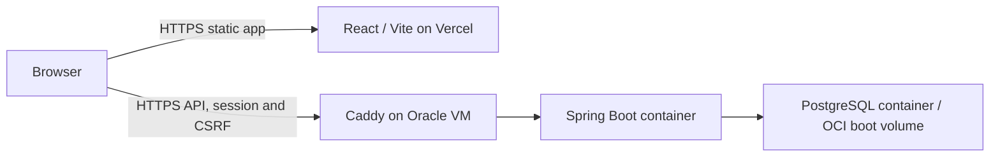

# aiops-ansible

Ansible-based DevOps automation workspace with Codex guidance for CI/CD,
Oracle Cloud Always Free hosting, and free-first implementations. Infrastructure
and deployment automation targets an existing Ubuntu 24.04 Oracle Cloud VM.

Project behavior and validation expectations live in [AGENTS.md](AGENTS.md).
The `.codex/` scaffold reserves project agents, skills, and explicit skill
registrations. Reusable capabilities come from the global `codex-environment`
installation; project copies of those definitions are unnecessary.

Example Codex requests:

- "Use $free-first-operations to review this project's Oracle Cloud allowances."
- "Use $infrastructure-as-code to implement the approved design with Ansible."
- "Use $pipeline-architecture and $free-first-operations to create CI within my allowance."
- "Have cloud-cost-reviewer review this resource plan and its cleanup costs."

Free-first means preferring existing resources and community tooling, verifying
actual hosted allowances, and documenting cost after credits expire. It does
not guarantee free hosting without verified account allowances. No cloud resources are provisioned by
this guidance setup.

## Application deployment

This repository deploys the sibling `../aiops/aiops-backend` application.
The React/Vite frontend lives on Vercel. **Oracle Cloud runs Spring Boot, PostgreSQL,
and Caddy**, all in Docker. PostgreSQL is private; only Caddy publishes public
ports 80/443. Backend port 8080 is bound to host loopback for health checks.



The local application is authoritative: it has Java 21, Spring Boot, PostgreSQL
17, Flyway and owner session authentication. Its frontend currently uses local
demo data and **does not call the backend**. These playbooks prepare hosting;
frontend API/auth integration is separate work. No frontend, CI runner, Maven
build, cloud provisioning, DNS changes or Vercel deployment runs on the VM here.

### Prerequisites

- An existing, dedicated **VM.Standard.A1.Flex**, initially **1 OCPU / 6 GB RAM**,
  in your OCI tenancy's home region. Select the Ubuntu 24.04 LTS **arm64** platform
  image (not Oracle Linux); SSH as `ubuntu` with sudo and Python 3.12. Bootstrap
  also supports Ubuntu 24.04 amd64 for an E2.1.Micro fallback described below.
- A 50 GB encrypted OCI boot volume is the starting assumption. All Docker
  volumes and local backups use this disk. Use a public subnet with a public IP,
  an internet gateway and an appropriate default route for packages/images/TLS.
  No NAT gateway, managed database or load balancer is required for this layout.
- OCI NSG/security-list ingress: TCP 22 from your administrator IP only, TCP
  80/443 for public HTTP/TLS. Review both layers: their allow rules combine, so
  a restrictive NSG does not cancel a broad subnet security-list SSH rule.
  Never allow 5432 or 8080. Keep SSH host-key verification enabled. Outbound DNS
  and HTTPS are needed for package/image downloads, TLS and optional APIs.
- Bootstrap adds only TCP 80/443 INPUT rules for IPv4/IPv6 and an
  `aiops-ingress.service` boot unit that reapplies them after
  `netfilter-persistent.service`. It preserves existing rules and does not flush
  tables or edit Oracle's OUTPUT/iSCSI protections. Do not enable UFW on the OCI
  Ubuntu image. Docker manages forwarding for its published container ports;
  the OCI NSG/security lists remain an essential external access boundary.
- A real API domain whose DNS points at the Oracle VM before deployment. Keep
  the address and DNS aligned if its public IP changes. Publish AAAA only if
  IPv6 routing and OCI ingress actually work. The INPUT rules cannot fix missing
  cloud ingress, routing, or pre-existing Docker/FORWARD restrictions; inspect
  those if the public health check fails.
- Prefer `app.yourdomain.com` on Vercel and `api.yourdomain.com` on OCI. These
  share a site for the backend's secure `SameSite=Lax` cookie. For unrelated
  sites such as `project.vercel.app` and your API domain, `aiops_cookie_same_site:
  none` enables cross-site cookies, but browser third-party-cookie blocking can
  still prevent login. Use an exact frontend HTTPS origin, with no trailing slash
  or wildcard. Requests will need `credentials: 'include'` and the existing CSRF
  contract. Vercel preview origins are not automatically trusted.

### Control node and offline checks

Run Ansible in **Linux/WSL**, with Python 3.12. Native Windows is not an Ansible
control node. Prefer a clone under the WSL home directory; if using this Windows
checkout through `/mnt/c`, explicitly set `ANSIBLE_CONFIG` because Ansible may
ignore configuration in a world-writable directory. The OCI SSH key belongs in
`~/.ssh` inside WSL with mode 0600, outside Git.

```bash
cd /mnt/c/Users/joshua/Desktop/aiops-ansible
export ANSIBLE_CONFIG="$PWD/ansible.cfg"
python3 -m venv .venv
source .venv/bin/activate
python -m pip install -r requirements.txt
ansible-galaxy collection install -r requirements.yml -p .ansible/collections
ansible-playbook -i inventories/production/hosts.example.yml playbooks/site.yml --syntax-check
ansible-lint
python scripts/validate_templates.py
```

These checks do not connect to Oracle Cloud. The examples use a static YAML inventory;
there is no cloud inventory plugin. `--check` on an actual inventory still contacts
that host and is not an offline check. On an unbootstrapped host it cannot
rehearse Docker/package installation reliably; live check mode is not tested.
Compose reconciliation and HTTP probes are deliberately skipped in check mode.

Collections/control-node dependencies are pinned. Host Docker packages track the
official stable Ubuntu repository at first installation (`state: present` does
not perform routine upgrades). Review Docker/Compose upgrades explicitly;
Compose **2.30+** is needed for `env_file.format: raw`. That mode preserves `$`
in BCrypt hashes and other secrets. The backend registry reference must be a
digest; local archives use a unique release tag. PostgreSQL/Caddy default to
major-version tags with pull-if-missing; pin their tested digests in vars.yml
for reproducible production releases, and update them deliberately.

### Prepare configuration and an image

```bash
cp inventories/production/hosts.example.yml inventories/production/hosts.yml
cp inventories/production/group_vars/aiops/vars.example.yml inventories/production/group_vars/aiops/vars.yml
cp inventories/production/group_vars/aiops/vault.example.yml inventories/production/group_vars/aiops/vault.yml
```

Edit the three local files. Set the OCI public IP/key, your domains, release image,
and image archive path. Put a random password of at least 24 characters and a
BCrypt hash with cost 12–16 into vault.yml. The existing backend script
`scripts/New-OwnerPasswordHash.ps1` generates the owner hash interactively.
Quote hashes in YAML. Configure optional model/OAuth credentials there only if
needed, then encrypt the file **before committing anything**:

```bash
ansible-vault encrypt inventories/production/group_vars/aiops/vault.yml
# Later edits:
ansible-vault edit inventories/production/group_vars/aiops/vault.yml
```

Local vars, inventory, Vault file and image archives are ignored by Git. Keep
the Vault password outside Git and backups. The playbook uses `no_log`/no diff
for secret work. Runtime secrets remain in root-only environment files on the VM
and are visible to privileged Docker administrators; do not grant untrusted
users Docker access. Never put API keys or OAuth secrets in Vite `VITE_*` values.

Build/test the backend on your PC or an isolated runner. With Docker Desktop
running, from PowerShell in `~/Desktop/aiops/aiops-backend`:

```powershell
.\mvnw.cmd test
docker build --platform linux/arm64 -t aiops-backend:release-001-arm64 .
docker save --output "$HOME/Desktop/aiops-backend-release-001-arm64.tar" aiops-backend:release-001-arm64
```

Use `aiops_backend_image: aiops-backend:release-001-arm64` and its absolute archive
path as seen by WSL. Each changed build needs a **new tag and archive**; never
overwrite a release tag. Ansible copies and loads it, then Compose uses
`pull_policy: never`. This requires no registry or cloud credentials. Keep old
release archives for rollback. Alternatively publish through your separately
authorized registry process, set the backend image to `registry/path@sha256:...`
and leave the archive empty. Private registries require a preconfigured,
root-owned Docker login with a read-only credential; this automation does not
configure registry credentials or publish images.

Docker Desktop needs a working ARM64 builder/emulation for that build on an
x86 PC. A native ARM builder is another option. The current Maven/Temurin base
images, PostgreSQL 17 Alpine and Caddy 2 Alpine advertise arm64 and amd64
manifests; an ARM application build/runtime still needs verification. Compose
pins `platform: linux/arm64` for A1. Ansible rejects a mismatched VM platform or
loaded archive before starting a release. Registry digests must identify a
matching image or a multi-platform index containing that platform. Do not reuse
an older amd64 archive on A1.

### Deployment commands (live host changes)

After filling the configuration, verifying the OCI SSH fingerprint through a
trusted channel, and confirming DNS, routing and OCI ingress:

```bash
# Full first installation:
ansible-playbook playbooks/site.yml --ask-vault-pass --limit aiops_oci
# Subsequent application releases, without package bootstrap:
ansible-playbook playbooks/deploy.yml --ask-vault-pass --limit aiops_oci
```

These commands modify the selected host. They are provided for a later
authorized deployment; creating this repository does not run them. No instance,
IAM, billing or network resources are created by the playbooks.

Deployment validates inputs/configuration, backs up an existing running database
before a changed release, reconciles Compose, checks `/api/health` over loopback,
then verifies public HTTPS and its certificate from the control node. The
endpoint reports app liveness, not a complete database/model/OAuth readiness
test. Finish with the backend's owner login/CSRF flow and a real database-backed
request; inspect `docker stats` and host memory under representative use.
Single-host updates have downtime and invalidate in-memory sessions.

### Backups, recovery and rollback

`aiops-backup.timer` makes daily PostgreSQL custom-format dumps at 02:00 UTC
with a randomized delay, retained for approximately seven days in
`/var/backups/aiops` (root-only). Changed releases also take a dump when an
existing database is running. Failed dumps stop that release. No dump is
possible when the existing database is stopped; recover it before an upgrade
if its data needs protecting. Environment-only changes recreate containers;
ordinary unchanged releases reconcile rather than force restarts.

Backups on the same OCI boot volume do **not** protect against disk/instance deletion.
The operator owns daily backup-success monitoring, off-host encrypted copies,
snapshot policy/retention, and a restore drill in an isolated authorized target.
Daily off-host copying gives a proposed RPO of up to 24 hours; RTO is unmeasured.
Back up the encrypted Vault file, its separately protected password, and the
stable Gmail encryption key too. Retained dumps contain personal data.

On the host, these are manual operational commands:

```bash
sudo systemctl start aiops-backup.service
sudo systemctl status aiops-backup.timer aiops-backup.service
sudo journalctl -u aiops-backup.service
sudo docker compose -p aiops -f /opt/aiops/compose.yml ps
```

For an application rollback, select the previous known-good image/tag/archive
in vars.yml and rerun deploy.yml. Flyway migrations run at backend startup;
image rollback is safe only when the old version accepts the current schema.
For an incompatible migration, stop writes/backend first, preserve the current
database, and restore a selected dump into an empty isolated database with
PostgreSQL 17 `pg_restore --exit-on-error --no-owner --no-privileges`, then verify
the matching application version before replacing production data. Restoring
production and dropping data require separate authorization. A volume with
existing data ignores changes to `POSTGRES_PASSWORD`/user/database defaults;
rotate database credentials with an explicit database migration, not by editing
Vault alone. Never upgrade PostgreSQL major versions by just changing the image.

Do not run `docker compose down -v` or prune volumes: that removes database and
TLS state. There is no automatic rollback, reboot, cleanup, host patching, or
off-host upload. The operator owns those actions and monitors backup failures,
disk growth, restart loops, TLS renewal and memory. Docker restart policies
recover containers after host restart; Caddy TLS state and PostgreSQL data are
named volumes on the boot volume. Logs are capped at three 10 MiB files per container.

### Oracle capacity and Always Free boundaries

The A1 default budgets are 1 GiB for Spring Boot, 512 MiB for PostgreSQL and
128 MiB for Caddy on the proposed 6 GB VM. JVM heap is capped at 512 MiB and
the connection pool at five. These are initial limits, not measured capacity.
Check cold startup, total RSS and restarts under your workload. Builds stay off
the VM. No automatic resizing or swap is configured.

If A1 capacity is unavailable and you choose **VM.Standard.E2.1.Micro** instead,
use Ubuntu 24.04 **amd64**, build a new `linux/amd64` release/archive, update
vars.yml to select it, and add `-e @examples/vars.micro.yml` to both initial and
later deployment commands. This explicit override selects amd64 and the earlier
512/192/64 MiB container limits with a 256 MiB JVM heap. The Micro's 1 GB RAM
is tight for Spring Boot and PostgreSQL; measure it rather than assuming fit.
The override is outside inventory group_vars so it is never loaded implicitly.

Oracle's Always Free documentation checked on **2026-10-05** lists A1 allowances
of **1,500 OCPU-hours / 9,000 GB-hours monthly (2 OCPUs / 12 GB total)**.
The proposed 1 OCPU / 6 GB VM uses at most 744 OCPU-hours / 4,464 GB-hours in a
31-day month, before other instances. Published storage allowance is 200 GB
combined boot/block volumes and five volume backups. A 50 GB boot volume uses
part of that allocation. Verify remaining capacity and eligibility in your
home region; older 4-OCPU/24-GB tutorials are not the default here.

**Expected eligible compute/storage cost is $0 within verified allowances,
including after promotional trial credits expire.** Tenancy eligibility,
remaining allowances, region and budget are currently unknown, so this is
conditional. Capacity may be unavailable. Idle Always Free VMs may be reclaimed;
keep encrypted off-host backups and a rebuild/restore plan for this personal app.
No artificial workload to avoid reclamation is configured.

If billed without the allowance, Oracle publishes A1 at $0.01/OCPU-hour and
$0.0015/GB-hour: 1 OCPU plus 6 GB for an illustrative 730-hour month is **$13.87
for compute**, before storage, backups, transfer and tax. Confirm those other
rates with the OCI estimator before using paid resources. Review boot-volume
performance settings and backup retention too. Model usage, domain/DNS, registry,
and Vercel plan costs remain separate; free VM hosting does not cover them.
The playbooks do not create OCI resources, upgrade a tenancy or alter quotas.

Sources checked 2026-10-05:
[Oracle Always Free resources](https://docs.oracle.com/en-us/iaas/Content/FreeTier/freetier_topic-Always_Free_Resources.htm),
[A1 paid pricing](https://www.oracle.com/cloud/compute/arm/),
[OCI network security](https://docs.oracle.com/en-us/iaas/Content/Network/Concepts/securityrules.htm),
[OCI firewall precautions](https://docs.oracle.com/en-us/iaas/Content/Compute/References/bestpracticescompute.htm),
[Docker Ubuntu installation](https://docs.docker.com/engine/install/ubuntu/),
[Ansible Compose module](https://docs.ansible.com/projects/ansible/latest/collections/community/docker/docker_compose_v2_module.html).

Set a lab expiry and budget before provisioning. On shutdown/cleanup the owner
must review retained boot/block volumes, snapshots, public addresses, backups,
DNS and registries; stopping a VM does not remove every retained resource or
potential charge. Keep resources inside confirmed allowances and monitor usage.
